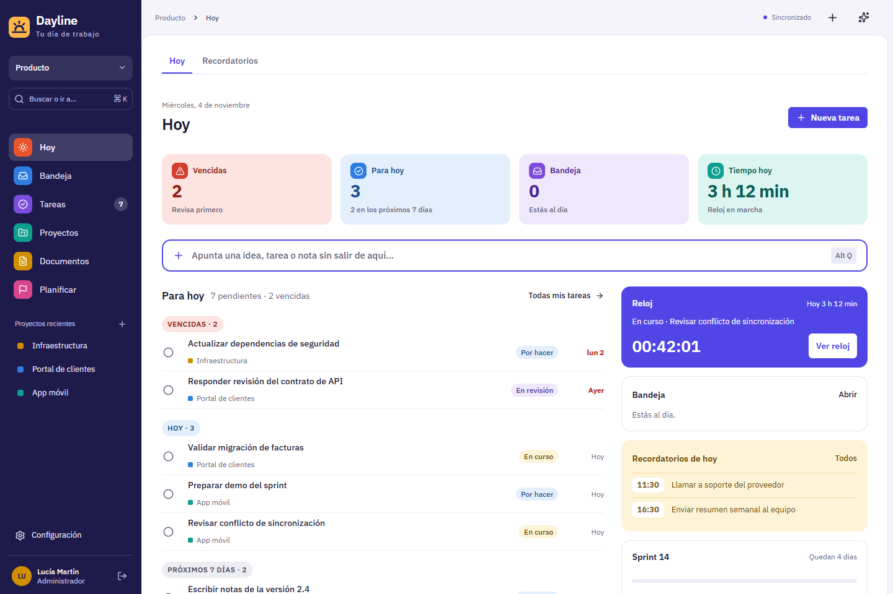
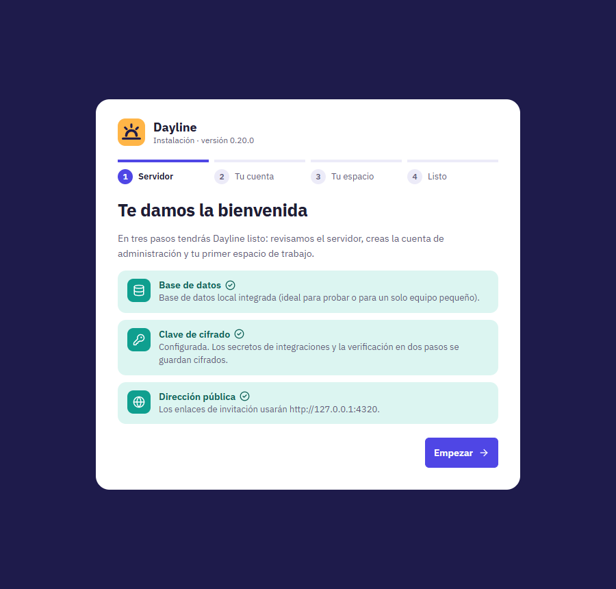
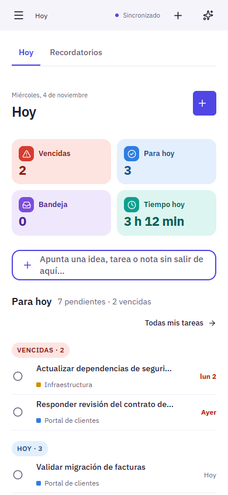
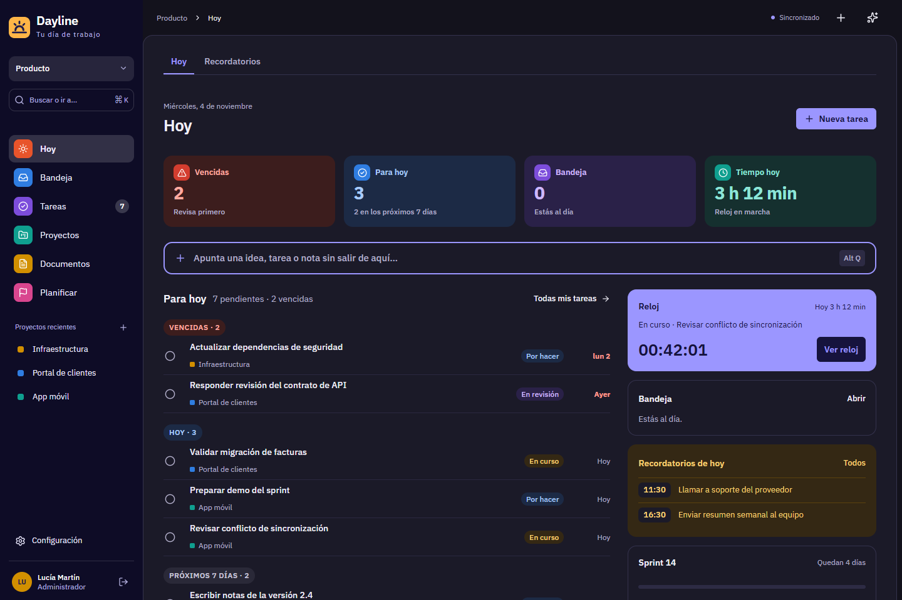

<div align="center">


# Dayline

**Your team's day of work in one place: tasks, documents and sprints.**

Self-hosted, offline-first and collaborative. Open it in the morning, see what's due, and get on with it.

[](https://github.com/gafapa/dayline/actions/workflows/ci.yml)




</div>

---

## Why Dayline

Most project tools open on a wall of boards. Dayline opens on **Hoy (Today)**:
- what's overdue
- what's due today
- your running clock
- unread mentions
- today's reminders
- the active sprint

Six destinations in the sidebar. Everything else lives one click deeper.

<table>
<tr>
<td width="33%" valign="top">

### 🟠 Daily work
- **Hoy:** due tasks, clock, inbox, reminders, sprint
- **Quick capture** from anywhere (`Alt Q`)
- Personal notes and reminders
- Inbox with quiet hours

</td>
<td width="33%" valign="top">

### 🟣 Projects and tasks
- Boards, lists and calendar
- **Your own workflow states** per project
- Custom fields, saved views, bulk edits
- Rules, recurrence and reminders

</td>
<td width="33%" valign="top">

### 🔵 Documents
- Real-time collaborative editor (Yjs)
- Works **offline** and syncs later
- Templates, folders, subprojects
- Exports to HTML, PDF and CSV

</td>
</tr>
<tr>
<td valign="top">

### 🩷 Planning
- Sprints with capacity and planning poker
- Burndown, burnup and reports
- Roadmap, milestones, releases, decisions
- Time tracking

</td>
<td valign="top">

### 🟢 Teams
- Several workspaces per person
- Roles: admin, member, read-only, guest
- Invitations and two-step verification
- **Platform admin panel**: accounts, suspensions, reset links, audit

</td>
<td valign="top">

### 🟡 Yours to run
- One Node service and PostgreSQL
- `docker compose up -d` with automatic HTTPS
- **Installation wizard** on first start
- Optional AI assistant with your own provider key

</td>
</tr>
</table>

<div align="center">

&nbsp;

&nbsp;

</div>

## Quick start

### Try it locally

You need Node.js 24. There's no Docker or database to set up: development uses an embedded PostgreSQL ([PGlite](https://pglite.dev)).

```bash
git clone https://github.com/gafapa/dayline.git
cd dayline
npm ci
npm run dev
```

Open http://127.0.0.1:5173 and the **installation wizard** walks you through it:
1. Server checks
2. Your administrator account
3. Your first workspace
4. Done

### Install it on a server

```bash
cp .env.example .env      # set APP_ORIGIN, DAYLINE_ADDRESS and three random secrets
docker compose up -d      # Dayline + PostgreSQL + Caddy (automatic HTTPS)
```

Then open your domain and complete the wizard. The full guide covers configuration, updates, backups and running without Docker: **[docs/self-hosting.md](docs/self-hosting.md)**.

## Development

```bash
npm run typecheck   # TypeScript
npm test            # 177 server and model tests (node:test)
npm run build       # web app, service worker and server bundle
```

**Browser checks.** 22 Playwright scenarios run against the compiled app, using synthetic data only:

```bash
ENCRYPTION_KEY=$(openssl rand -hex 32) npm run preview   # in another terminal
node scripts/browser-check.mjs                            # runs the wizard and creates the test account
node scripts/verify-browser.mjs                           # every scenario
```

All of this runs on every push in [GitHub Actions](.github/workflows/ci.yml).

### How it's built

| Layer | Choices |
|---|---|
| Web | React, Vite, lucide icons, IBM Plex Sans |
| Editor | Tiptap and Yjs over Hocuspocus, with local Yjs persistence |
| Offline | Service-worker app shell, IndexedDB snapshots and a durable command outbox |
| API | Fastify, zod validation, same-origin session cookies, rate limits |
| Data | PostgreSQL transactions with optimistic concurrency; PGlite in development |
| Background work | Automations, reminders and digests on a PostgreSQL queue in the same process |

### Project layout

```
src/        React app (screens, offline store, editor)
server/     Fastify API, collaboration server, migrations, workers
shared/     Model, validation and workflow rules used by both sides
tests/      Server and model tests
scripts/    Browser checks and build helpers
docs/       Behaviour notes for each feature, plus self-hosting
```

Each feature has a short behaviour note in `docs/`, for example [workflow states](docs/workflow.md), [sprints](docs/sprints.md), [offline documents](docs/document-protocol.md), [platform administration](docs/platform.md) and [design direction](docs/design.md).

## Security notes

- The installation wizard is protected by `SETUP_TOKEN` and only appears while no account exists.
- `ENCRYPTION_KEY` encrypts authenticator secrets and AI keys. Back it up with your database.
- Recovery codes and password-reset links are stored only as hashes.
- Found a vulnerability? Please open a private security advisory on GitHub rather than a public issue.

## License

No license has been chosen yet. Until one is added, all rights are reserved.
